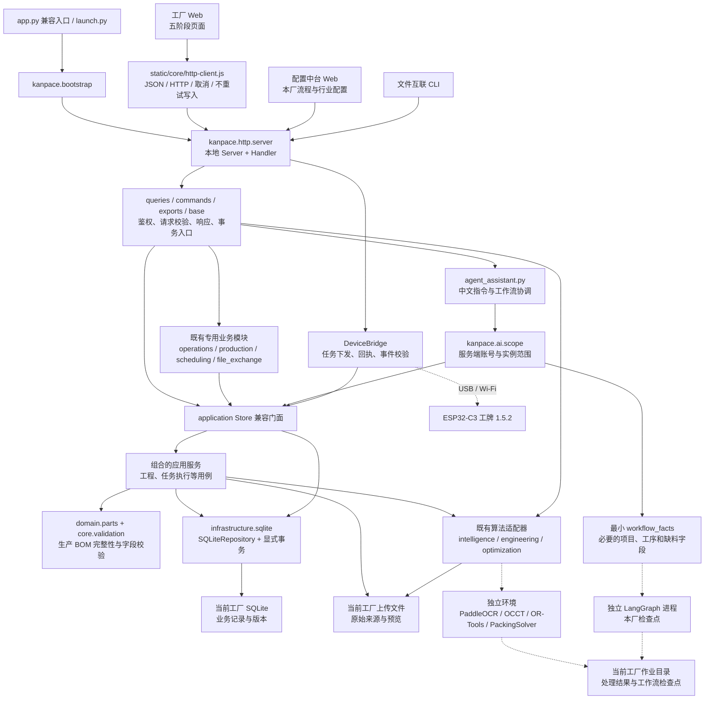

# KANPACE 架构与重构边界

版本：2026-09-08。本文件描述本轮实际代码结构及兼容边界。最终验证结果在文末记录，不能以目录存在代替行为验证。

## 1. 架构目标

采用**模块化单体 Web + 独立算法进程 + 独立工厂实例**。工厂仍从五阶段 Web 处理订单；配置中台、算法、助手和工牌围绕相同的工程来源、订单、工序和执行版本协作。

这次重构优先分离已经混在根 `app.py` 中的接口、业务服务、规则和持久化，并建立前端网络与助手范围的明确契约。保留数据库格式、HTTP 路径、工牌协议和已有订单记录，避免用一次性重写置换已验证的业务规则。

它不是全量 Clean Architecture 改写，不是分布式微服务系统，也没有因此获得通用模型自动准确拆单的能力。更清晰的架构用于让已有算法和下一阶段能力有可测试、可替换的接入位置。

## 2. 当前调用关系

下图表达运行时调用与数据归属，虚线表示独立进程或设备边界；不是承诺所有模块已经满足单向导入规则。

实际保留的兼容模块既可能由 HTTP 路由调用，也可能由应用服务调用。新层次没有把根目录所有模块改成空壳，更没有将它们自动转换为独立服务。

## 3. 代码边界与职责

| 位置 | 本轮实际职责 | 不负责的事情 |
|---|---|---|
| 根 `app.py` | 兼容既有启动方式和公开导入名称 | 不继续承载全部实现 |
| `kanpace/bootstrap.py` | 解析本机启动参数、装配 Store 与 Server | 不定义生产规则 |
| `kanpace/core/` | APIError、数值/文字校验、常量、旧记录字段投影 | 不启动服务器或算法进程 |
| `kanpace/domain/parts.py` | 生产 BOM 完整性检查 | 不把 OCR 文本自动认作合格构件 |
| `kanpace/infrastructure/sqlite.py` | 连接、记录读写、兼容读取和显式事务上下文 | 不自行逐条提交一个完整业务用例 |
| `kanpace/application/` | Store 门面和组合的业务服务；继续承接旧方法契约 | 不以继承层数代替领域拆分 |
| `kanpace/http/` | 基础请求处理、查询、命令、导出与本地服务组合 | 不信任浏览器声明的角色或工厂权限 |
| `kanpace/ai/scope.py` | 当前账号、工厂、项目、任务的可见范围；输出最小工作流事实 | 不接受模型或文档内容修改权限 |
| `static/core/http-client.js` | 可注入 fetch 的 JSON 传输、错误和取消契约 | 不操作 DOM、业务状态、权限或自动重试 |
| 根目录专业模块 | 既有生产、排程、报价、文件、算法和硬件实现 | 尚未全部迁入新的包目录 |

Store 是迁移中的兼容门面。原有调用者仍可传入同一连接并调用 `store.generate(...)`、`store.release(...)`、执行与资料方法，实际实现由组合的服务承担。新服务之间使用明确依赖和传入的连接，避免使用“从 Store 类所属模块反射寻找规则”这种隐式耦合。

本轮 Store 仍继承 `SQLiteRepository`，以保留既有 `all/get/put/connect` 数据访问接口；业务行为由下列八个服务组合实现。`application/ports.py` 的 `ManufacturingPort` 声明服务需要的内部能力，它不是暴露给模型的任意工具对象。

| 组合服务 | 实际边界 |
|---|---|
| `ProjectService` | 建单、项目关闭与重新开启 |
| `EngineeringService` | 文件导入、构件修订、工程变更、生成与发布 |
| `ExecutionService` | 人员分配、执行版本、前序限制、进度、暂停、恢复与切换 |
| `DeviceExecutionService` | 校验工牌事件、投递身份与幂等回执，调用同一执行规则 |
| `ResourceService` | 人员、技能、计价设置、订单费用与报价 |
| `QueryService` | 原有状态快照与读取契约 |
| `AuditService` | 事件与当前账号的审计归属 |
| `BootstrapService` | 默认设置、实例识别与按启动参数控制的演示初始化 |

`core/records.py` 保留旧记录别名与读取投影，仍复用既有 `fulfillment` 兼容逻辑。这是实际保留的旧模块依赖，不把该目录描述为已经完全纯化的领域层。

## 4. 事务与并发

### SQLite 内的一个业务用例

`SQLiteRepository` 继续使用现有 `entities`、`config` 表与 JSON 记录格式，启用 WAL。没有在本轮把客户数据重写成新关系模型，也没有引入 ORM 或切换数据库。

- `read_transaction()` 建立读取快照，默认开启 `PRAGMA query_only=ON`，结束后关闭连接。
- `write_transaction()` 使用 `BEGIN IMMEDIATE`。同一业务用例中的多条记录和事件统一提交，异常时统一回滚。
- 应用服务接收调用者的连接，不在每次 `put()` 后提交。
- 同一线程、同一数据库禁止隐式开启第二个独立事务；内部服务复用当前连接，避免独立提交或等待自己的写锁。
- 工程版本、执行版本、配置版本与幂等请求编号继续由原业务接口验证。数据库事务不会替代业务版本检查。

常规命令路由接入显式写事务，助手查询使用只读事务。一部分既有查询和专用适配器仍保留 `connect()` 与原有快照处理；不宣称所有查询路径已统一迁移。

### 数据库以外的操作

识图作业、排程求解、工作流检查点、文件落盘和工牌 Flash 不与主 SQLite 数据库共享一个原子提交。专用模块保留各自的任务 ID、工程版本、摘要、投递 ID、事件 ID 和状态核对。

设备连接或传输等待不占用一个普通生产写事务。算法先计算或产生候选，应用阶段重新验证版本与范围。网络断开时，前端不自动重放写请求；使用者先核对最新记录，专用幂等接口仍按原契约恢复。

## 5. 工厂与账号边界

一个独立客户工厂对应独立数据目录、数据库、上传与缓存、账号会话、设备凭证、算法作业目录以及后台 Web 进程。主工作台负责开通实例，独立工厂不能枚举或创建别的客户实例。

工厂类型、项目参数和业务表筛选只缩小当前实例中可见的数据，不能扩大到别的实例。公共代码、公开模型和行业参考目录可以共用；本厂来源文件和修改后的流程不自动写回公共库。

应用内岗位权限由服务端认证和业务接口检查。同一实例内的项目与原文件按该实例权限机制共享；前端隐藏菜单不是权限验证，类型选择器也不是保密隔离。

当前实例开通依赖 macOS launchd，并绑定本机地址。进程与目录分离不等于操作系统沙箱，拥有本机管理权限的人仍可能访问磁盘。HTTPS、局域网/云端多人部署、容器隔离和分布式访问控制需要独立设计与验证，不属于这次目录重构自动获得的能力。

## 6. AI、算法与工程依据

### 助手看到什么

`build_scope()` 从当前 Store、服务端已认证账号和允许的工厂类型构建 AgentScope。工人或质检范围限制为本人关联任务；没有关联人员时不回退为全厂权限。请求中的 actor、角色、自述身份、对话历史和图纸文字不能提升这个范围。

传给独立 LangGraph 工作进程的 `workflow_facts()` 是明确字段投影：必要的订单信息、当前工程版本的工序、前后序、负责人、已知工时标记与关联缺料。原始图纸、自由备注、财务数据、文件路径和凭证不通过此事实包输出。工程 OCR/CAD 处理有独立的、按当前工厂验证的来源文件路径，不能将助手事实投影与识图输入混为一谈。

助手检查复用领域完整性规则及发布相关业务检查，不另造一套“AI 认为可以发布”的条件。助手给出的写操作继续走原接口和版本校验。

### 算法如何接入

PaddleOCR、Open CASCADE、OR-Tools、PackingSolver 和 LangGraph 使用既有适配器及独立运行环境。输入输出通过文件或结构化数据传递，作业和检查点归当前工厂。基础 Web 不要求将大型原生依赖装入自身解释器。

工程结果保留来源摘要、页码/位置/实体及处理状态。模型外形、OCR 文字或参考工时不会直接变成审批过的生产事实。引擎无法运行、信息不足或没有可行解时返回真实状态；人工复核与采用动作仍在业务流程中。

当前包含 OCR 模型推理和确定性分析工作流，不是训练完成的自有制造业基础模型，也不是可自主修改任何记录的通用 Agent。后续增加模型应复用同一范围、工具、证据和版本契约，而不是允许模型直接写数据库。

## 7. 前端改造完成到哪里

本轮统一了工厂主应用的常规 API、任务执行、工牌、账号与 Agent 查询传输。新客户端可独立注入 fetch 测试，统一以下契约：

1. HTTP 错误保留 `status` 和结构化 `details`，409 的任务/版本冲突信息不丢失。
2. 网络故障、JSON 格式异常和主动取消分别处理。
3. 请求只有一次尝试；不自动重复提交派工、进度、费用或交付。
4. 主动取消后，即使底层迟到返回，也不接受旧结果。
5. 错误展示、登录入口、工牌特殊状态仍由对应 UI 适配器负责。

没有改动已验证的五阶段布局，也没有添加 React、打包器或另一套导航。仍待解耦的部分包括：

- `static/app.js` 的全局 `state`、选中项目和页面变量。
- `render()` 的页面选择、DOM 替换、取数与设备轮询混合职责。
- `refresh()` 对全量快照和多个缓存的统一刷新。
- 各业务模块分别维护的请求令牌、作用域和缓存生命周期。
- 配置中台等独立页面仍有各自请求适配；未全部切换主应用的 HTTP 客户端。
- 部分旧测试仍按源码片段抽取函数，新核心测试已经直接加载模块。

这些部分应按页面激活/退出、查询快照和作用域生命周期逐个迁移，并维持现有浏览器操作回归。

## 8. 架构决策记录

### ADR-01：模块化单体作为当前部署单位

**决定：** 一个工厂保留一个 Web 业务服务，算法维持独立进程。

**原因：** 订单、工程版本、任务、物料与交付共享很多事务约束。当前本地部署需要易启动、可离线使用、便于恢复；拆成许多网络服务会增加部署与一致性成本。

**代价：** Web 进程和 SQLite 的并发能力仍有上限。未来拆出服务需要实际负载与故障隔离证据，不能以目录数量推断伸缩能力。

### ADR-02：兼容入口 + 组合应用服务

**决定：** 根 `app.py` 保持旧启动和必要导出，Store 保持旧方法契约，方法实现委托组合服务。

**原因：** CLI、硬件、专题模块与测试已经使用这些接口。先建立内部职责边界，可以保留运行行为，再逐项迁移调用者。

**代价：** 兼容门面与既有模块依赖会暂时存在。新增功能应进入合适服务，不再把实现堆回启动文件；兼容导出不能成为新的业务模块反向依赖入口。

### ADR-03：保留数据格式，集中事务所有权

**决定：** 沿用 SQLite 表和现有 JSON 数据，新增明确的读写事务边界；服务复用同一连接。

**原因：** 此次目标是降低耦合、保持业务规则与资料连续性，数据库重建会引入额外迁移风险。

**代价：** 记录字段仍大量使用字典与兼容别名，不能宣称已经完成全量类型化领域模型。后续需按实体逐步强化契约和迁移机制。

### ADR-04：AI 先满足范围和证据契约

**决定：** 使用服务端 AgentScope 和最小工作流事实，算法或模型输出经原业务接口采用。

**原因：** 拆单价值依赖来源可信、版本正确、工艺匹配与可复核。把完整数据库或原文直接交给通用模型并允许任意写入，会失去这些约束。

**代价：** 当前助手的自由推理和自主操作范围有限。后续能力扩大需增加可测工具与工程评估集，不能用回答流畅程度替代拆单正确率。

### ADR-05：先统一传输，再迁移前端状态

**决定：** 本轮提取无 DOM 的 HTTP 核心并接现有适配器，保持页面与导航。

**原因：** 错误、取消和写入重试直接影响生产数据可靠性；边界小、可独立测试，也为后续状态管理提供稳定基础。

**代价：** 全局状态和重渲染仍存在。下一步应抽取带作用域的刷新协调器与页面生命周期，独立验证后再评估是否需要框架迁移。

## 9. 验证记录

架构验证需要分别证明模块实际装配、行为保持、事务和权限边界、页面可用性与交付完整性。不能把旧报告或仅导入成功视为全部完成。

| 项目 | 本轮结果 |
|---|---|
| 前端 JSON 传输与受影响前端合约 | `node --test tests/*.cjs`：30 文件，Node 汇总 131/131，通过；包含 18 项新传输合约。 |
| Store、兼容入口与 HTTP 行为 | 最终后端全量 636 项：621 项通过、15 项在默认环境跳过；对应 15 项专用引擎测试另行全部通过。应用架构 11 项和提交响应契约 2 项包含在全量中。 |
| SQLite 快照、写事务、回滚与连接释放 | 架构仓储与初始化 19 项通过；真实任务切换中途失败时，任务和审计记录同时回滚。已有数据初始化不引入演示记录。 |
| AgentScope、最小事实及权限回归 | 新 Agent 架构 10 项包含在全量中；账号、工厂隔离、工程依据与 LangGraph 真实工作流回归通过。 |
| 桌面与手机实际页面 | 已在运行服务检查场景切换、订单、施工图和效果图、当前订单助手。390 × 844 下助手宽度及页面宽度均为 390，取消与关闭正常；浏览器错误/警告记录为空。 |
| 原业务数据核对与源码交付 | 重构前后 10 类 804 条业务记录及配置表内容摘要一致。交付工具已包含新的 kanpace 包、前端核心与本文；交付包独立启动和摘要结果另记于包旁的源码包验证结果。 |

详细命令、补测关系与验证边界见 [本轮验证报告](../verification/20260908-架构重构验证.md)。执行日志保留在本机 `work/architecture-20260908/`，不随通用源码分发。补测包含真实 OCR、STEP、OR-Tools 与 PackingSolver；同名重复用例不重复累计。

## 初始化与提交确认补充

SQLiteRepository 只建立存储结构并读取实例身份，不创建设置或演示业务。BootstrapService 在单个写事务中按旧启动参数初始化设置、人员和演示订单，锁内重新核对已有工厂标记。初始化故障整体回滚。工程来源绑定接口在提交成功后才返回成功响应，并在写锁内重新鉴权。
