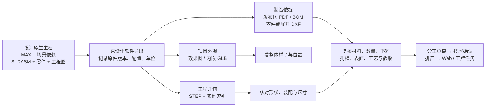

# KANPACE：CAD 资料与工程依据审计

日期：2026-09-07。范围为当前源码、已归档的桥接验证状态，以及 Autodesk / SOLIDWORKS 官方文档。本轮没有转换客户模型、上传资料、修改生产代码或运行 CAD 软件。

**结论：原生工程文件作为主档保留，网页读取派生文件方便看图，制造字段依据已发布工程资料形成。三者必须有关联，不能互相冒充。** 目前 KANPACE 已具备真实模型查看、STEP 几何核验、OCR 原文定位和显式 BOM 导入；尚不具备 3ds Max 或 SOLIDWORKS 的原生编辑/重建能力。目标应先落在设计交底之后的资料整理、拆单复核、分工和版本发放。

## 1. 先纠正当前页面的判断

当前主页面 `static/project-visual.js` **已使用本项目真实效果图**。它只在有本项目实际上传模型时显示“3D 模型”，并加载 `/model/index.html`，没有把缺失效果图自动变成方盒。

另一个 `static/project-3d/` 是仍可直接访问的旧页：`scene-data.mjs` 读取整柜清单三轴/直径，`app.js:71–81` 生成 BoxGeometry / CylinderGeometry，按目录网格摆放，并由材质文字选示意颜色。`static/navigation-map/features.js` 已将其列为 legacy。旧页属于**尺寸示意**，不是效果图、现场空间或工程模型；本轮已将其“3D 总览”标题改为“清单尺寸示意”，并注明未读取原设计模型。不能据此误判当前主图还在推演造模。

更直接的现存问题是：`projectVisualModelDocument()` 在符合后缀的模型中取 `.at(-1)`，**最后上传的一块零件也可能顶替整项目模型**。系统尚无明确“本订单整体展示模型”“某个柜体加工模型”的角色和主模型选择。

## 2. 三层资料：保留、看见、制造

这里的箭头表示资料来源和复核关系，不表示当前全部导出/识别能力已经自动实现。效果图进入的是外观交底；加工任务应引用工程图页码/区域、零件号、版本以及相关模型实例。

| 层级 | 要保留什么 | 能回答什么 | 不应据此承诺什么 |
| --- | --- | --- | --- |
| 原生工程主档 | 原文件、依赖、应用版本、配置、发布日期、负责人 | 设计在什么软件里完成，后续谁能修改/重建 | 单个后缀上传成功就代表全部依赖齐全 |
| 派生可视文件 | JPG/PNG 效果图；内嵌 GLB；从 CAD 导出的 STEP；来源主档/版本 | 项目样子、外观、结构、装配关系、几何核验 | 像素或网格能够自动补足材质牌号、公差、制造数量、工艺 |
| 制造信息 | 已发布施工/零件图、BOM、展开图、板件表、材料表、工艺要求及复核结果 | 谁加工哪个件、做几件、按哪张图、做哪些步骤、如何验收 | 任意模型都可直接生成正确的制造 BOM 或机床程序 |

## 3. 文件类型和原设计软件的实际边界

**3ds Max。** `.max` 是原生场景文件；纹理、XRef 场景/对象等可以在外部。应由设计端使用 Archive 打包引用文件，并记录 Max 版本、使用的渲染器/插件。Archive 收集文件不等于把商业插件本身及其授权一起打包。Autodesk 的官方说明明确 Archive 包含当前场景及纹理、容器、XRef 等引用内容。[Autodesk：文件管理与 Archive](https://help.autodesk.com/cloudhelp/2026/ENU/3DSMax-Manage-Scenes/files/GUID-B21BA733-2749-4EBF-B6A3-FC8912389518.htm)

3ds Max 2026 可导出 GLB，适合网页交互展示；官方导出器会展平层级，不导出动画/蒙皮/变形器，对材质及贴图有约束。因此应核对外观和对象命名，不能把 GLB 宣称为完整 MAX 工程树的替代品。本项目当前只接受**资源内嵌的 GLB**，不接受外链贴图；OBJ 解析后统一材质，也没有配套 MTL 上传链，不能承诺它还原效果图材质。[Autodesk：导出 glTF/GLB 及限制](https://help.autodesk.com/cloudhelp/2026/CHS/3DSMax-Interoperability/files/GUID-5B4C8EC2-2230-4F9F-B3C6-48D9E347E37D.htm)

不能把所有 Max 对象一概叫“无精度网格”：官方 SAT 导出支持保留 Body Objects 的实体几何；但将普通网格转换输出会得到许多小平面，不能据此恢复设计意图。本应用当前也没有 SAT 导入器。这一事实**不赋予任意效果场景制造 BOM**。[Autodesk：SAT 导出](https://help.autodesk.com/cloudhelp/2026/ENU/3DSMax-Interoperability/files/GUID-E2F3B8B6-9C07-4CB0-A8EC-FD36DB764B49.htm)

**SOLIDWORKS。** 官方区分 `.sldprt` 零件、`.sldasm` 装配、`.slddrw` 工程图。应通过 Pack and Go 收集实际引用零件/子装配、工程图、设计表等，并明确本次配置；不能只收一份顶层 SLDASM。工程图自身也可能引用模型。[文件类型](https://help.solidworks.com/2025/English/SolidWorks/acadhelp/c_Types_of_Files.htm)、[Pack and Go](https://help.solidworks.com/2024/english/SolidWorks/sldworks/c_pack_and_go.htm)

STEP 是派生工程几何，能传递实体、拓扑以及导出器支持的名称/结构/颜色/单位，不是原生特征历史的原样保存。重新进行特征识别与恢复原始建模顺序不同；SOLIDWORKS 自己也有单独的 FeatureWorks 或导入模型参数化转换功能，本项目没有这些功能。[STEP 文件](https://help.solidworks.com/2026/English/SolidWorks/sldworks/c_Step_Files.htm)、[官方导入体特征识别](https://help.solidworks.com/2021/english/solidworks/fworks/t_Recognizing_Features_Using_step_by_step.htm)、[2026 参数化转换功能](https://help.solidworks.com/2026/english/WhatsNew/c_wn2026_import_convert_imp_mods_para_geom.htm)

AP242 可按相应 MBD 功能/导出选项带出自定义属性等信息，不能因此声称任意 STEP 都含 PMI，也不能声称 KANPACE 已读取。当前桥接固定 AP214；当前后端明确未解析 PMI、密度或重量。钣金制造还应从已审核 Flat-Pattern 导出下料 DXF，不能用折弯后 STEP 外包尺寸代替展开尺寸。[STEP242 属性导出](https://help.solidworks.com/2024/english/SolidWorks/sldworks/t_exporting_custom_prop_step_242.htm)、[钣金展开 DXF](https://help.solidworks.com/2026/English/SolidWorks/sldworks/t_Saving_Sheet_Metal_Flat_Patterns_DXF_Files.htm)

## 4. 现有能力与未实现项

| 当前入口/模块 | 已有实现事实 | 尚未实现或必须复核 |
| --- | --- | --- |
| `static/project-visual.js` | 项目效果图去重与选择；当前上传模型 iframe 查看 | 无原生主档—派生文件关系；无指定项目主模型，默认最后一个符合后缀的文件 |
| `static/model/app.js`、`occt-worker.js` | STEP/IGES/BREP 转显示网格；GLB/OBJ/STL 查看；选择、隔离、爆炸、剖切、表面两点测距；单文件 20 MB 限制 | 无 `.max/.sldprt/.sldasm/.slddrw` 解析；无 CAD 特征树/尺寸约束编辑、配合求解、真实拆装顺序。爆炸是节点方向位移；剖切不生成工程剖面；测距基于显示网格 |
| `model_workspace.py` | 保存某文档 `mesh-N` 与既有拆单项的人工关联，检查项目归属和零件修订 | 节点不是料号，节点数量不是订单数量；没有跨版本稳定实例自动匹配，也不从模型自动造 BOM |
| `engineering_engines.py:513–648` | 本地 OCCT 读取 STEP 原始 B-rep、实例/定义、面积体积、单位、有效性、世界轴对齐外包框 | 外包框明确不是下料尺寸；不读取原生 SW 历史、PMI、材质密度，不自动恢复工艺/制造 BOM |
| PaddleOCR 管线 | 图片/PDF 页码、原文、区域坐标、置信分数及来源留存 | 文字识别不能自动判定哪组数字属于哪个件、成品尺寸还是展开尺寸；仍需图文复核 |
| `engine.py:179–233` | 显式 CSV/JSON BOM 与受限 ASCII DXF 解析；其他文件保留并给指引 | 原生 CAD 上传不等于读取；PDF 传统解析提示尚未关联新 OCR 能力，容易给人“上传没发生变化”的感受 |
| `engine.py:308–449` | DXF 的若干二维实体和属性；只对明确带生产属性的闭合轴对齐矩形补长度/宽度 | 不读二进制 DXF；不展开块几何；bulge 仅折线预览；一般图层线条不自动当 BOM；不能冒充完整 AutoCAD 解析器 |
| `bridges/Export-SolidWorksBOM.ps1` | 设计为读取当前已解析装配实例、自定义/配置属性，导出 CSV+审计；下料尺寸要求 CF_Cut 属性 | 只过 PowerShell/C# 静态检查，未完成 Windows+SW 实机；非原工程图 BOM 表原样导出；未处理焊件切割清单、多实体拆件、钣金展开及完整 BOM 排除/提升规则 |
| `bridges/Export-SolidWorksModel.ps1` | 设计为调用原生 STEP AP214 导出并保留 occurrence 索引、配置、来源和哈希 | 只过静态/API 契约检查；未实机核对几何/配置；occurrences.csv 不是下料清单，不能按网格序号直接配料号 |

桥接验证状态来源：[bridges/README.md](../../bridges/README.md)、[bridges/MODEL-EXPORT.md](../../bridges/MODEL-EXPORT.md)。真实本地引擎验收来源：[工程引擎验收](../verification/20260907-真实工程引擎验收.md)。本报告没有重新运行它们。

## 5. 这类展示柜到底用什么资料拆

优先使用施工图之后、工艺员已经拆出的零件/板件/五金/玻璃加工图与清单；原项目的效果图保留为定位和外观说明。不同工种应读到不同工程依据：

| 工种 | 主要加工依据 | 不能从效果图/普通 STEP 自动补出的信息 |
| --- | --- | --- |
| 木作 | 板件表、零件尺寸图/开孔开槽图、材料规格、封边/纹理要求 | 净尺寸/下料余量、封边厚度与边序、纹理配板、连接孔位 |
| 五金加工 | 零件图、焊接图、型材切割表；钣金需正式展开图 | 材料牌号、焊缝、折弯扣除/方向、加工公差、表面处理 |
| 玻璃及外协 | 分片编号、尺寸/孔位、边加工和钢化要求 | 玻璃类型、磨边/倒角、公差、开孔与钢化前后关系 |
| 灯光/电气 | 型号表、接线图、线路/安装位置、检验要求 | 电源匹配、回路、线缆规格、保护/验收要求 |
| 总装/安装/质检 | 发布装配图、部件齐套清单、安装节点、验收项；辅以整项目模型 | 真实装配顺序、现场约束、交接条件、已批准变更 |

当资料只有效果图或 Max 外观场景时，系统可以整理柜型、标记位置并形成**待工程确认的分工范围**，不能进入确定尺寸的下料发布。只有 PDF 时可以先 OCR 与原图同屏复核；有发布 BOM/拆解图时应直接复用，不要求把每个工厂都先改成使用 SolidWorks。

## 6. 最小修改建议：让人一眼知道下一步

1. 将 `/model` 的“3D 拆单”改为“看模型”，默认只露出旋转、选择柜体、关联加工资料；把爆炸、剖切和测距放到“更多工具”。旧 `project-3d` 改为“尺寸示意（旧版）”或退出正常入口。不要再加长篇免责文字填满界面。
2. 项目资料固定三块：**整体效果、加工图与清单、原始工程文件**。每块只显示文件名/版本、可用状态和一项下一步操作。主模型由技术员指定，不能取最后上传文件；GLB 展示模型和 STEP 加工核验模型分别标识用途。
3. 上传后给实际结果：`可看整体`、`已识别待核对`、`缺零件/待设计端导出`。`.sldasm` 显示依赖清单/配置要求，`.max` 显示场景导出要求；没有实际解析器就不显示“自动拆单完成”。PDF 可直接到页码+识别区域复核入口。
4. “生成分工草稿”只引用已存在构件与明确来源。每项任务显示一张有关图、零件/柜体名称、做什么、数量和验收要求。图纸变更后让受影响任务重新确认，而不是让工人自行翻版本。
5. 原生主档到派生文件至少记录：工厂/项目、原件 ID+SHA、修订、配置、导出应用/版本、单位、导出时间、相关文件列表、用途、审核人。实例与料号作为单独关系，不能以网格序号代替企业零件身份。
6. 下一次真正补 CAD 能力，应先在设计端跑通一张真实小装配：原生包 → 发布 BOM+PDF+STEP → 数量/配置/至少三个已知尺寸对照 → 派发一个工种。再按本厂需求补切割清单/钣金展开/孔槽提取；这比先承诺完整浏览器 CAD 编辑器更接近真实交付。

Document Manager 是另一条可评估的原生资料读取路径，不是当前已集成能力：官方说明它无需安装完整 SW，但需要相应 API 许可密钥，功能类别与文件版本受密钥约束，不能随软件分发企业密钥。它不能因名称是“文档管理”就被当作免费通用 CAD 内核。[官方 API 起步与许可](https://help.solidworks.com/2024/English/api/swdocmgrapi/GettingStarted-swdocmgrapi.html)、[官方 API 范围](https://help.solidworks.com/2024/english/api/swdocmgrapi/Welcome-swdocmgrapi.html)

## 7. KANPACE 替代哪一环节

可先替代的是技术拆单后的重复抄表、资料与零件人工对号、按工种整理任务、版本通知、进度追问及异常交接。几何内核、OCR、优化器帮助核对和安排工作；生产工艺员的发布权和原设计软件仍保留。

可配置工厂中台的长期对象应是 **工程资料 → 企业料号/构件 → 制造版本 → 工序路线 → 资源/外协 → 工单 → 实绩**。同一底层对象适配不同工厂，字段映射、BOM 层级、路线规则与审核要求按工厂版本化。`engine.py` 当前 `cabinet-v1.0` 的类别路线和工时只是展示柜规则基线，不能因为导入相同 STEP 后缀，就把这些工序直接套给机械装配、石材、卫浴或电子车间。
