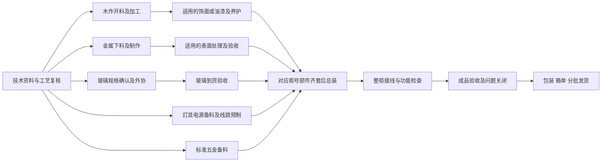

# KANPACE 现场交底产品主线

日期：2026-09-07。本文是基于当前代码与验证资料的产品规划，不是已经完成的功能说明，也不是某个客户订单的拆单结果。目标使用者是 50 岁以上制造业老板、40 岁以上主管，以及需要边干活边看任务的工人。

**核心结果：技术员把已确认的工程资料交进来，班组拿到能看懂、能准备、能验收的图文任务包；老板知道哪个交付会被什么问题卡住、由谁处理。**

第一项可以替代的人工工作是：技术员、助理和班组长反复找图、裁图、抄部件编号与数量、整理不同工种的交底单、查漏项并通过聊天逐人解释。工程判断和放行仍由对应人员负责。以这一段节约的时间及减少的现场追问验收，不先以功能数量评价产品。

## 1. 现有能力和当前断点

| 现有基础 | 对现场的意义 | 需要收拢的产品断点 |
|---|---|---|
| `engine.py` 保留来源，按木作、五金、玻璃、电气等生成草稿路线 | 可以从经确认的零件资料整理分工 | 工艺模板和 OCR 结果尚不能代替制造尺寸与特殊工艺确认；模板初始工时是可编辑假设 |
| `engineering_engines.py` 与工程引擎支持扫描文字定位、STEP 装配节点及实例 | 能让技术员返回原图核对文字、装配关系和几何 | OCR 分数不是尺寸准确率，STEP 外包尺寸不是下料尺寸；缺少的材料、PMI 或原生 SolidWorks 数据不能补猜 |
| `operations.py` 具备三类场景、工作对象、流程模板、复核和版本迁移 | 同一系统可以换成柜体、机械子装配或施工区域 | 应围绕工作对象交底，不要求新用户先理解模板、工作中心和数据实体 |
| `planning.py` 人日排程；`scheduling.py` 分钟级有限容量试算 | 可以把依赖、人员、工位、准备及等待放进计划 | 计划可排、资料已发、允许开工、工人开工是四件事，当前界面需避免混淆 |
| `production.py` 齐套、开工检查、异常、质检与返工门槛 | 现场问题能阻断受影响工序，并留下责任人 | 这些检查应在任务包内完成，减少来回去物料、异常、任务等独立页面找信息 |
| 工牌任务首页、施工图与效果图、暂停和确认回执 | 工人可以少翻页看当前任务 | 图应优先对应本工序、本构件；硬件不适合承担全项目浏览和长表格录入 |
| Excel 互联、有效作业段、工时校准 | 能沿用现有表格，并逐渐获得本厂参考工时 | 导入只需由助理或主管做一次映射；老板无需学习 CSV、字段映射、P50 等术语 |

早期《技术与能力边界》《暂停换单与急单操作》中的部分硬件和引擎状态已被后续实现更新。本文按代码及较新的工程引擎、工牌、四阶段和排程验证记录判断，不把旧“尚未实现”说明当作当前状态；各项真实能力仍以对应验收范围为准。

## 2. 从老板和班组的问题出发

| 使用者当下的问题 | 首屏应给出的结果 | 不要求他先学会的概念 |
|---|---|---|
| 老板：这周能交哪些，卡在哪里？ | 交期风险项目、影响节点、责任人、承诺解除时间，点一项进入处理 | 预测模型、置信度、图数据库、集成协议 |
| 主管：今天派谁，谁缺料，可以换做什么？ | 可开工任务、正在做、暂停待处理、可以接替的任务，并显示资源冲突 | DAG、排程指纹、实体关联 |
| 技术员：这批图能不能直接交给车间？ | 缺哪些加工信息、哪些有冲突、各工种将收到的任务包预览 | OCR 作业 ID、CAD 节点底层类型 |
| 工人：我现在具体做什么，怎么做完？ | 项目/柜号、部件/工序、当前版本图、数量、关键要求、开始或继续 | 全订单成本、系统接入状态、后台操作说明 |

任何“待处理”必须有具体事项和处理人；任何“可以开工”必须有可检查的依据。项目效果图负责认识整体外观，施工图、拆件图和经确认模型数据负责生产依据。

## 3. 一只综合展示柜的完整样例

### 样例假设，不能用于生产

以下为虚构教学对象 `演示柜 C-01`，假设订单只有 1 台，包含木作柜体、金属框架、玻璃门、灯具和标准五金。柜体编号、文件代号和分支名称仅用于解释流程，不对应任何真实客户。**长、宽、高、板厚、门缝、孔位、玻璃规格、电气参数、每种零件数量以及公差全部留空，须从本次批准资料获取。** 不将整柜 1 台推算成每种零件 1 件。

假设交进来的资料有四类，允许其中一类缺失：

| 输入 | 用途 | 接收时必须记录 |
|---|---|---|
| `R-效果图` | 看整体外观、部件位置和饰面意图 | 来源、版本、对应柜号；不能从透视图估算尺寸 |
| `D-施工图` | 整体关系、立剖面、节点与说明 | 图号、页码、修订、单位、批准状态；同图多视图不能重复计量 |
| `P-拆件图/零件表` | 板件或金属零件实际加工信息 | 零件号、材料、数量单位、加工尺寸、工艺和验收依据 |
| `S-SolidWorks 装配` | 实例层级、配置、零件属性和关联模型 | 导出配置、源文件/版本、实例路径、单位，缺失/抑制组件清单；通过已安装 SolidWorks 的导出桥接或 STEP/BOM 获取可读数据 |

只有效果图时，可以建项目、归档和提出深化清单，不能生成可下料生产任务。只有施工图时，可以生成“技术深化待确认”的分工草稿，缺加工尺寸的木板不放行。没有原始 3D 模型时，展示真实效果图；单张效果图不能凭空提供可转动且尺寸可信的 3D 实体。

### 从接单到工人开工

| 步骤 | 主责人 | 输入与动作 | 明确输出与放行点 |
|---|---|---|---|
| 1. 建档收图 | 跟单/助理 | 引用原 Excel 订单号，登记交期、柜号和原文件 | 一个项目资料篮；上传结果显示已保存、识别中、需转换或失败及下一步 |
| 2. 确定当前版本 | 技术员 | 对比修订、同名文件、图号和内容摘要 | 当前批准版本及历史版；相同图内容归并引用，不删除证据，不把重复图变成两倍需求 |
| 3. 列工作对象 | 技术员 | 按柜体→部件→材料层级确认清单，关联对应原图区域和模型实例 | C-01 对象树、每种对象数量与单位、未解问题；效果图、三视图、真实重复实例明确区分 |
| 4. 整理图文交底 | 系统生成，技术员确认 | 从已有信息预填工种、做法、局部图、验收要求；不够的信息集中提问 | 每个工种的草稿包和“还缺什么”；冲突字段显示两个来源供裁决，不静默取最后上传值 |
| 5. 核准工艺与准备 | 工艺/班组长，仓管配合 | 确认加工顺序、设备、材料和前序验收；登记准备、加工、等待估计 | 可发布任务、仅可备料任务、技术待确认任务分清；齐套指已验收且为该任务预留 |
| 6. 排程与派工 | 生产主管 | 依据交期、资源容量、前置和到料日试算，再确认负责人和时间 | 已确认计划及具体负责人；预计到料只支持条件计划，实际开始仍检查齐套 |
| 7. 发交底包 | 主管/班组长 | 先查看工人预览，再发送当前任务及两张必要图片 | 设备收到对应任务版本的回执；收件不等于工人开工 |
| 8. 开工 | 指定工人，必要时班组长确认 | 读图、核对编号和材料、查看尚未满足条件 | 门槛满足后“开始”；版本过期、缺料或异常未解除时明确提示原因及联系人 |

### 这个柜体的并行和串行

这是需由本厂工艺员确认的示例。免漆材料不得自动插入油漆；金属表面处理的实际位置、玻璃复尺时点、电气预埋顺序由图纸和做法决定。例如玻璃必须待框架实测后定尺，就应增加“框架尺寸确认→玻璃下单”依赖，不能因为玻璃属于另一个部门就默认可同时投产。

不同分支只有在不同人员及工位均有容量时才可并行。两个工种共用一台设备也会形成资源串行。汇合按本柜号需要的部件等待，避免 C-02 的玻璃缺料阻断已经齐套的 C-01；当前 `engine.generate_tasks` 的末端总装是订单级汇合，后续必须优先改为柜号/装配单元范围的汇合，才能支持实际分批交付。

### 木工收到的一包，应当具体到什么程度

此处的字段值仍为占位，并未核定任何真实尺寸。

| 工人看到 | 内容要求 | 缺失时如何处理 |
|---|---|---|
| 做什么 | C-01 / 零件号 W-侧板 / 开料与孔槽加工；工艺决定是否拆成两道任务 | 对象不清时返回技术员确认，不发“做柜子”这样的泛任务 |
| 看哪张图 | 已批准拆件图的侧板局部图，带零件号、版本及原页入口；另可看整体效果图定位 | 缺拆件图时给技术深化任务；不能拿效果图当加工图 |
| 做多少 | 从发布 BOM 读取“本批数量 + 件”，已做/剩余与同一口径一致 | 数量缺失留待确认，不默认 1，不把台、件、米相加 |
| 怎么做 | 已确认的材质/厚度/纹理方向、基准边、孔槽/封边要求；关键文字与原图定位一致 | 未明确的孔位、公差、接口要求进入问题单 |
| 用什么 | 材料规格、预留数量及领料位置；本厂设备/夹具要求 | 缺料只阻断引用此材料的任务分支 |
| 做完给谁 | 下一工序或接收人、半成品位置、需要一起移交的图和附件 | 不用“完成”替代实物交接，转序由约定门槛放行 |
| 怎么算合格 | 按原图指定基准和验收项目检查，异常转交质检或技术 | 系统不自定加工公差，关键项目无依据不得自动合格 |
| 当前动作 | 开始；进行中为暂停/完成；暂停时为查看原因/恢复 | 对不允许的动作直接给缺项与处理人，不让工人猜按钮为什么灰色 |

建议合并相同料、相同做法且便于同批加工的零件操作显示，但每个零件号、版本、数量和完成记录仍可追溯。不要为每一个尺寸字段生成一张任务卡，也不要合并不同配置或不同验收要求的零件。

## 4. 工时必须分开估，不能给一个虚假的总小时数

每道节点保留三项：准备时间、有效加工时间、工后等待。采购/外协还需承诺到货日或区间。具体数值由班组长核定，后续用实际有效作业段校准；上面的 C-01 不填任何假装来自图纸的工时。

计算依据应可以展开：准备分钟 + 单件有效分钟 × 本批件数 + 明确的调整依据。养护、运输、供应商等待影响可转序时间，不能算成工人一直在加工。多个分支的总交付时长由资源和最慢汇合分支决定，不能简单把所有工种工时相加。

已有样本时内部可使用本厂同工艺的 P50/P80；用户界面称“通常用时”“预留时间”，并显示样本数与适用范围。没有同类样本显示“待班组确认”。不要把 `engine.py` 中的初始每件系数包装成识图后准确预测。

## 5. 暂停、插单、交接和工牌闭环

| 现场发生什么 | 工人操作 | 系统与主管应接住什么 |
|---|---|---|
| 材料做到一半不够 | 暂停→缺材料，保留累计整件数；补一句半成品位置与加工到哪一步 | 原因关联具体任务和材料；明确补料责任人和预计解除时间；释放该工人的执行占用 |
| 遇到图纸、质量或设备问题 | 暂停→对应原因；长描述由主管补录 | 自动带项目、任务、版本；转给对应责任人，异常未关闭不能仅凭“恢复”绕过 |
| 来了急单 | 主管先看插单影响，确认换做；工人确认原任务交接 | 原任务暂停与新任务开工原子处理；目标仍须版本、技能、物料、前序合格；不静默移动冻结计划 |
| 急单结束 | 提交完成并满足验收后，看到原暂停任务的返回入口 | 原任务保留已做数量和交接；恢复必须说明原阻碍已解除，不把“急单结束”当作缺料已解决 |
| 换班/换人 | 暂停并交接当前加工状态、存放点、未完项 | 接收人确认范围和版本后继续；未知进度显示“待核对”，不能当 0 |
| 掉线或回执未到 | 动作显示待确认，继续显示已缓存的当前图 | 同一事件唯一 ID 重传不重复记量；不得把“已发送”显示成“已开工/已完成” |
| 改图 | 工人看到版本变化和处理事项 | 受影响任务重新审查；已加工数量和旧证据保留，不能被新任务覆盖 |
| 项目已完成并发货 | 当前任务退出可派列表 | 历史图、任务与交接可查；不得继续给关闭项目派新生产任务 |

工牌主屏只保留：项目/对象、任务、数量/状态、当前局部施工图入口、下一步动作。效果图放“看整体”入口；完整要点按需打开。Wi-Fi 用状态图标，待确认和失败只显示处理需要的信息。开始/完成保持一次明确确认；缺料暂停先用少量原因按钮，不要求在小屏填写长表格。

不增加“拍摄”作为必经生产工序。个别质量或交接需要的附件由该环节按实际要求提供，不能让所有工人多一道操作。

## 6. 三个行业共用什么，分别换什么

统一内核只有这些对象：项目与版本、可交付工作对象、部件/材料及来源、工序依赖、负责人/技能/资源、开工条件、任务包、执行事件、异常及交接、质量门槛、交付记录。每个客户保存自己的模板和工时样本，不能自动把一厂经验应用到另一厂。

| 模板变化 | 展柜工厂 | 机械设备装配 | 装修工程现场 |
|---|---|---|---|
| 最小可交付对象 | 柜号/同批部件 | 设备序列号/装配单元 | 楼层/区域/房间/作业面 |
| 工程资料 | 效果图、施工图、拆件图、BOM | 装配结构、机加工图、电气图、配置表 | 施工图、节点、现场变更、区域边界 |
| 典型并行 | 木作、五金、玻璃外协、灯具备料 | 机架模块与电控柜准备 | 已放行的不同区域分别施工 |
| 典型串行 | 加工→饰面/养护；对应部件齐套→总装 | 子装配验收→总装→联调→出厂验收 | 前序作业面交接→隐蔽验收→封闭/饰面 |
| 关键门槛 | 板件与玻璃规格、接口、色号、齐套 | 配置一致、紧固/接线与测试依据 | 作业面、材料到区域、前序验收、现场许可 |
| 工人首屏要突出 | 柜号、部件图、数量、做法 | 设备号、装配位置、图号、检验要点 | 区域、位置图、施工范围、交接条件 |
| 交付证据 | 柜号/箱号/附件对应 | 设备号、实际装机清单、测试档案 | 分区验收、整改关闭、移交记录 |

首次开通只问六件事：行业和工作对象怎么叫、现行流程表、工种班组及负责人、需要哪些开工确认、需要哪些验收、现有 Excel 哪份表负责哪类数据。系统给本厂模板预览，主管划掉不适用节点、补依赖，再发布第一个版本。行业模板是起点，不代表本厂流程已经获批准；不要求第一次就填写所有设备、计价或系统接口。

## 7. 菜单最少化建议

建议先做四个日常业务大组，每组保持看得见的小标题。这里是后续产品调整建议，不要求把本轮已完成的六组导航马上重做。

| 大组 | 直接可见的小标题 | 默认展示 |
|---|---|---|
| 今天要办 | 今日生产、缺料与异常、待确认事项 | 老板看交期风险与责任人，主管看待处理事项，工人看本人当前任务 |
| 项目与图纸 | 项目订单、图纸与拆件、任务交底 | 项目整体图与当前版本，进入后以柜号/装配单元/区域组织资料 |
| 排产与派工 | 生产排程、任务分配、完工与交付 | 可开工队列与当前负荷；质量检查就地办理，保留直接入口 |
| 经营情况 | 交期与产能、成本与收款 | 老板关心的行动项和有依据的数字；按财务权限显示 |

“工牌连接”“工厂设置”“帮助”作为固定辅助入口；设置里放人员设备、流程模板、Excel 互联和工时参考，相关业务页同时提供就近入口。比如缺料页可以直接“导入物料表”，不能要求主管记住它藏在哪一层设置里。常用的缺料、异常、派工、排程、交付不得只藏在设置或助手里。

全局助手写成“帮我办事”，固定给“找任务、查缺料、看交期、给某人派任务”例句。查询直接回答并带相关图/按钮；写入先显示对象、当前状态、将改变什么，确认后执行。助手不会成为找到基本功能的唯一方式，也不要求使用者学写提示词。

视觉验收基准：正常正文建议 16–18 px、主要可点区域至少约 44 px；按钮直接写“派给谁”“查看缺料”“恢复任务”等结果；同一动作全站同名。颜色之外有文字状态；不把所有细节挤在首屏，也不把必需动作藏进只有图标的更多菜单。具体尺寸以目标用户实测为准。

## 8. 精度、速度和现场可用性如何验收

先选三个资料完整的已完成项目建立经技术员批准的基准，再用至少两个没有参与模板调整的独立项目盲测。优先覆盖木作饰面、金属玻璃、含电气的综合柜；同项目的复印图、改版和相同柜型不能拆成训练与测试两组。此数量仅是启动建议，不证明普遍适用。

所有门槛均为建议试点目标，不是本系统已取得的结果。

| 指标 | 怎么测 | 建议放行要求 |
|---|---|---|
| 工程字段正确 | 按零件逐项核对已填尺寸、单位、数量、材料、版本；未知单独统计 | 发布包中所有生产关键字段有依据且经确认；无依据值为 0 项 |
| 关键任务遗漏 | 人工金标准对比结构、电气、玻璃外协、质量门槛和交接依赖 | 已发布试点包关键遗漏 0；出现则停止受影响包并复核规则 |
| 重复与实例 | 注入两张相同图、多视图、重复实例、不同配置的样例 | 同图不多计，同定义的真实实例不漏计，不同配置不误合并 |
| 来源可追溯 | 从每个已发布包点击返回文件版本、原页/实例 | 需追溯内容 100% 能定位；测试工牌与网页版本一致 |
| 人工整理时间 | 从收到资料到批准交底包，统计找图、补字段、改错、复核的实际人工分钟 | 与人工基线相比，建议中位时间降低 30%，且质量门槛不降低 |
| 识别等待时间 | 单独统计上传至首个有用结果、全任务完成，记录页数、像素/模型节点和设备配置 | 不承诺统一秒数；必须显示状态和失败原因，长任务可退出回来查 |
| 工人看懂任务 | 让目标年龄用户无口头指导回答“做什么/看哪图/多少/怎么验收” | 首轮建议 5 人以上覆盖主要岗位，全部识别关键事项；记录卡住位置逐项修，不只做满意度问卷 |
| 关键操作可达 | 从首页分别找缺料、找图、暂停、派工、查交期 | 常用页面不超过两次导航点击；确认步骤另计，不能为减少点击取消有效确认 |
| 执行可靠性 | 开始/暂停/恢复/完成及重复、断线、旧版本、冲突测试 | 不重复计量；无未满足门槛开工；每个失败可知道原因和处理人 |
| 排程可执行 | 核对人员与工位占用、等待、外协到料、汇合、插单影响 | 无静默容量冲突与前序越过；未知工时不补 0；采用预览后不擅自更改实绩 |

准确性报告要同时给分母、错误例子和人工修改次数，不能只展示一个“识别率”。速度报告同时给中位数与较慢案例，不能删除复杂柜或长图来制造提升。

## 9. 老板愿意买单的收益怎么采集

先随一个班组和一批订单做基线，再用同类项目试用两到四周；记录订单复杂度、数量、变更、人员、外协与资料完整度，注明无法直接比较的差异。不要用试点前后总营收变化直接归因软件。

| 收益或成本 | 最小采集字段 | 归集责任 |
|---|---|---|
| 交底整理节约 | 项目/包 ID、人工起止、找图/整理/补问/复核/改错分钟、操作者 | 技术主管抽查，操作者记录 |
| 现场追问减少 | 任务、提问类别、发起/答复时间、涉及人员、是否因图纸缺失/冲突 | 班组长按事件登记，区分等待与双方投入时间 |
| 缺料和异常等待 | 暂停原因、起止、实际影响人数/工位、责任人、解除依据 | 生产主管与仓管，不能把所有暂停时间当可节省时间 |
| 返工损失 | 原任务、原因、返工人工/材料/外协、是否与错误资料交底有关 | 质检确认归因，财务核定金额 |
| 急单影响 | 插单前后预计交期、被推迟订单、批准人、实际额外加班/物流 | 排产主管与财务 |
| 使用成本 | 软件/硬件投入、部署培训、维护、电池/损耗、额外录入人工 | 老板或财务 |

劳动效率价值 = 经核验减少的投入工时 × 本厂认可的小时成本；只有减少了加班、外包、增员或形成可核验新增有效产出时，才另列现金收益。同一笔人工不能同时计入节约工时和返工费用两次。

月净价值 = 可归因的人工效率价值 + 可核验减少的材料/外协/物流损失 − 软件、硬件摊销、维护及新增录入成本。现金净收益另列。回本月份仅在月净现金收益为正且样本足够时计算：一次性投入 ÷ 月净现金收益；不足就显示“样本不足”，不预先许诺回本周期。

老板首页最终应能回答：“本周这些交付存在这些风险；已定位到这些任务和责任人；处理后节约或避免的损失有哪些可查记录。”任务完成百分比不能自动换算为收入、利润或回款。

## 10. 建议先完成的一个闭环

1. 在一个真实柜号上选定当前版效果图、施工图、拆件图/BOM，形成可审核的对象清单；相同原图只保留一份内容、多处引用。
2. 在同一页面整理木作、五金、玻璃、电气任务交底，缺项明确给技术员，不跨页找信息。
3. 用柜号范围组织工序汇合，核定资源、齐套与验收后派到真实负责人；先不要求客户录入全部历史库存和成本。
4. 发送局部施工图和整体效果图到工牌，完成一次真实的开工→缺料暂停→换做另一合格任务→交接→恢复→质检→交付。
5. 完整记录人工整理时间、现场追问、暂停原因和返工。只有这一闭环稳定且有收益依据，再将模板复制到第二种柜型、机械装配单元或工程区域。

这一主线的优先实现点是“按对象集中生成和复核图文交底包”，其次是“以同一任务包串联准备、执行和交接”。新的开源引擎、报表和助手都应服务于这两项结果。

## 依据

本次只读核对 `engine.py` 的 `generate_tasks`、`operations.py` 的行业模板/工作包编译/复核门槛、`planning.py`、`production.py` 的齐套/开工/质量/有效作业段逻辑，并参考：

- [工程引擎当前能力](../engineering-engines.md)
- [原始订单草稿与待复核边界](../真实订单拆单草稿接口.md)
- [四阶段实现与验收](../verification/KANPACE四阶段实现与验收.md)
- [有限产能排程验证](../有限产能排程验证.md)
- [表格互联与实绩校准](../表格互联与实绩校准接口.md)
- [工牌图片与简洁任务卡验收](../verification/工牌图片与简洁任务卡验收.md)

采用 `mfg-production-planning` 技能的“需求→物料→资源→现场执行”检查顺序；没有直接套用其长期批量生产时间窗，也没有添加外部市场排名或收益承诺。工作目录未发现 `_docs/` 目录，本次以 `docs/` 现有说明及代码为依据。本文未更改任何业务代码或生产数据。
