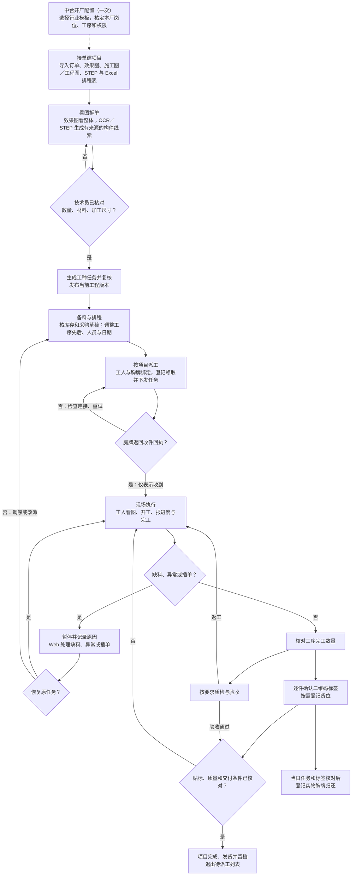
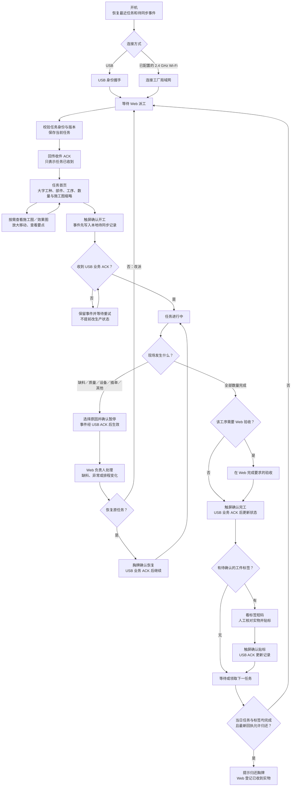

# KANPACE 软件端与智能胸牌端流程图

以下按当前代码可执行的流程绘制。软件端包含一次性的中台开厂配置和每个订单重复执行的工厂流程；硬件端按仓库中的 ESP32-C3 固件源码绘制。效果图用于看项目整体，施工图、工程图和 STEP 模型用于提出并核对构件候选；候选不是可直接下料的 BOM。

## 软件端：从建厂到订单发货

软件图中，收件回执与开工记录分开；工序完工、贴标确认、质检和发货也分别记录。新版本图纸会使旧工程依据失效，需重新复核。物料环节目前生成可审核的采购草稿，并不自动向供应商下单。项目关闭前会核对未完任务与质量问题；不把图上的正常主线误认为唯一合法关闭方式。

## 硬件端：工人拿到胸牌之后

当前 Wi‑Fi 能接收任务；图像传输、开工／暂停／恢复／完工和贴标业务回执走 USB。胸牌只缓存最近一项任务，不是整日离线任务队列。图册最多保留六张 JPEG。硬件外观概念中的摄像头扫码、拍照录像、AI 质检、旋钮和橙色侧键没有画入已实现流程。

## 两端交接点

| 交接 | 软件端记录 | 胸牌端显示或操作 |
| --- | --- | --- |
| 派工 | 当前工程版本、任务、人员与胸牌绑定；记录设备收件回执 | 收到并保存当前任务，显示大字任务与图册 |
| 开工与异常 | 按业务事件更新进度；缺料／插单由管理者处理排程 | 工人确认开工，选原因暂停，等待同步确认 |
| 完工与标签 | 单独记录工序完工、质检与每件标签确认 | 工人确认数量、核对标签短码并贴实物 |
| 归还 | 检查领取任务与标签后登记实物归还 | 最新回执允许时提示归还胸牌 |

实现依据：[每日工作协议](../DAILY-WORKFLOW-R32.md)、[真实自动拆图算法](../engineering/真实自动拆图算法.md)、`static/daily-workflow.js`、`kanpace/application/project_dispatch.py`、`firmware/goldenmorning-display/src/cabinet_badge.h` 与 `firmware/goldenmorning-display/src/cabinet_execution.h`。固件图反映仓库中的 1.6.1 源码与主机测试；本版尚无实板刷机验证记录。
