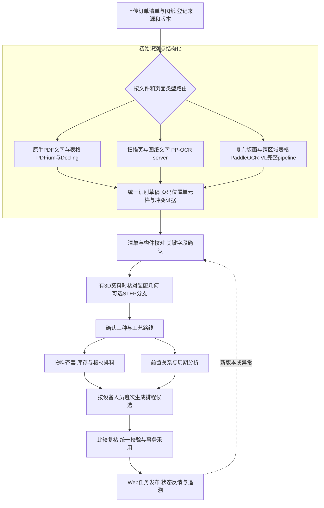

# KANPACE Web云端升级与商用许可方案

更新日期：2026-10-04。本版按用户实际操作流程组织功能，将同一环节用到的技术放在一起，并保留目前方案、建议方案、输出、验收与商用条件。目标为Web云端产品：其他电脑通过浏览器操作，计算、资料、模型和求解器由云端运行。个人电脑配置不限定选型。之前的硬件、外形/FPC、固件和无线任务已取消。

本窗口继续软件功能升级；服务器选型、已购腾讯云资产、租用配置和压测采购移至独立对话《KANPACE服务器选型与部署》。本文件仍说明软件对云端的职责要求，实例购买明细另见服务器专项文件。以下均为待实施设计；本轮调整方案与复核现有引擎状态，未安装新引擎、修改业务代码或部署新服务器。

## 1. 按一份订单走完整操作流程

用户操作主线为：**上传订单与图纸 → 初始识别与结构化 → 核对柜号/构件/BOM → 按需要核对3D与几何 → 确认工种和工艺路线 → 用料/排料与周期分析 → 资源排程 → 比较、复核并采用 → Web任务执行与追溯。**

Docling、PDFium、PP-OCR server和PaddleOCR-VL1.6共同组成最初的“识别与结构化”功能，按文件和页面类型分工，统一生成可回到原资料位置的识别草稿。它们不要求用户分别打开四个工具。后续工艺、排料和排程复用这份经过核对的数据。

图中是默认业务依赖，不要求所有订单都走CAD分支，也不要求周期分析等待排料算法完成。物料齐套状态与排料形成的批次/释放时间最终进入排程；新图纸版本、物料或工艺变化会使受影响的候选失效并要求重新核对。助手、持久工作流和权限审计贯穿各环节。

## 2. 操作流程、原方案与建议方案对照

“目前”来自用户状态表、现有代码和本轮只读核查，不推断云服务器已有什么能力。“建议”是功能升级的目标方案。已存在的功能保留并增强，不把已有约束重新当作全部新增。

|操作环节|技术 / 用途|目前的方案是什么|建议采用和替换的方案|新增能力、输出与采用条件|
|---|---|---|---|---|
|01 资料上传与版本登记|接收下单清单、PDF、扫描图、Excel和可选STEP；绑定订单/工厂/修订|已有资料导入、角色/修订、来源记录；主要依赖本机文件和原型Web|Web上传到私有对象存储；服务端生成document_id、真实文件hash、revision、资料角色与访问范围；保留结构化表格适配器|形成统一资料包；后续结果可定位至对应版本；重复上传、断网重试有幂等；用户确认订单与用途，效果图不直接当制造依据|
|02 初始识别与结构化|**PDF文字/表格解析 + OCR文字定位 + 复杂页结构解析，归为一个识别功能**|Poppler文字输出+规则猜表行；PP-OCRv5 mobile识别图中文字及位置；输出待复核草稿|**原生PDF：PDFium处理页面/渲染与文字基础，Docling解析版面/表格；扫描页和图纸文字：PP-OCR server+局部重识别；复杂页：PaddleOCR-VL1.6完整pipeline。Excel/CSV按工作表与单元格直接读取。**统一路由与输出，保留旧解析作对照|读出柜号、数量、材料、文字、表格行与尺寸候选；保留页码/bbox/polygon/单元格/来源版本；未处理页/区域与失败明确列出；冲突进入核对，不自动确定制造尺寸或工艺|
|03 核对清单、柜号与构件归属|跨页BOM、数量、合并单元格、图纸与清单对应，建立字段证据|可读取柜号/数量/材料/可识别行，按本柜与定位明细做规则关联；复杂表格/跨区域归属能力有限|在统一识别草稿上关联柜→构件→表格行→图纸区域；建立兼容EvidenceRef导入；相同字段多来源交叉核验；未知和矛盾明确展示|得到经复核的构件明细和BOM候选；用户可点字段回看原页/原单元格；材料、数量、厚度和加工尺寸等关键字段确认后才进入相应正式计算|
|04 核对图纸与3D几何（按资料需要）|STEP装配、实例/变换/单位、尺寸依据、可选PMI与特征；浏览器3D核对|OCP7.8/XDE可读定义/实例/变换/单位/bbox/面积/体积；尚无PMI读取；另有浏览器OCCT WASM|保留OCCT，主要几何移Linux云worker；有语义PMI才读并关联面；输出mesh/LOD/face映射给Three.js；AAGNet本厂特征小试验可选|核对零件数、毫米/英寸、装配实例、孔槽候选及来源；没有STEP也可按已有2D证据继续；bbox不直接当加工尺寸，无PMI不伪读|
|05 拆分工种与确认工艺路线|把构件变为工种、工序、前置关系与所需资源候选|已有按本柜清单和构件明细的确定性工种规则；不自动确定具体加工工艺|本厂批准的工艺路线库+规则/授权案例检索+图纸/几何证据；模型解释缺项并提出候选，工艺员确认材料/设备/刀具/表面处理条件|由“工种说明”增强为可核准工艺路线；缺厚度、工艺参数、设备或工时则保留缺口，不生成虚假生产依据|
|06 用料、库存与板材排料|齐套分析、选板材规格、切割布局、余料与库存占用|PackingSolver单规格矩形齐头切；已有材质/厚度/纹理/旋转/锯缝/裁边/切割树校验|保留PackingSolver；增加真实机器profile、缺陷、多板规格成本、可用数量与经确认余料；排料候选用独立校验器验现行约束|输出合法切割方案、板数/成本/余料候选及缺料清单；正式采用时核验库存并事务预留/消费，不能重复分配同一余料；未证明不称最优|
|07 前置关系、周期与关键路径|解释哪些工序决定交期、哪些时长未知；作为排程输入与诊断|自有CPM最长路径；节点时长可来自订单日期差/历史p50，按日历天计算|保留CPM；分清日历周期、加工、被动等待与资源占用；记录来源/确认；增加slack与情景解释|输出输入口径下的关键路径、余量与缺失时长；历史日历时长不直接换成加工分钟；仅在口径一致时解释相应资源模型下界|
|08 资源排程与方案比较|按已确认工序、设备/人员、班次、前序和齐套生成候选|内置启发式可预览；OR-Tools接入代码存在但默认运行时不可用；代码已有部分前序/资源/班次/不可中断处理|恢复服务端CP-SAT运行；保留合法启发式回退；统一输入与独立validator；增强柔性设备/人员、换型、已确认批容量、冻结段与稳定重排；PyJobShop作建模对照|比较交期、延期、换型和变更量；输出真实求解status/bound/gap；未知工时列阻断或明确what-if；所有回退同样验约束，不能把预览标为已证明最优|
|09 复核方案并正式采用|用户比较识别/工艺/排料/排程结果，确认后绑定正式版本|已有草稿、预览、版本绑定及采用校验；不同候选/回退的校验链仍需统一检查|Web集中展示差异、证据、缺口与风险；采用服务重查源hash/revision、人员权限、库存与资源版本；同一事务提交；模型不直接发布|清楚区分识别草稿、计算候选与已采用计划；旧资料、越权、约束不合法或库存竞争拒绝；确认一个环节不自动批准全部后续结果|
|10 Web任务执行、状态反馈与追溯|按已采用计划发布任务、查看依据、记录状态/异常并触发复核|已有Web任务/履约及来源追溯模块；当前以原型服务运行|复用领域服务接生产Web API；任务引用采用的计划/图纸版本；状态事件有event_id、执行版本、幂等、审计与回滚/重排入口|多电脑查看同一订单与当前任务版本；能追踪谁在何时采用/变更；已采用排程不自动解除暂停、缺料或工程未放行；异常与换版触发复核；不扩硬件报工|

### 2.1 “初始识别”内部如何分工

这一组属于同一功能入口，不是四套互不相干的系统，也不是每个文件都强制跑全部模型。原生读取优先；同页混有扫描区域时可以按区域补OCR；复杂页按需要触发VLM完整管线。

|输入场景|负责的技术|统一提供什么|需要核验什么|
|---|---|---|---|
|原生文字PDF、原生表格|PDFium+Docling；兼容旧Poppler结果对照|页面/文字位置、表格结构、行列/合并单元格候选与原页引用|字段、行列、单位、跨页关联和构件归属，避免保留文字却错配柜号|
|扫描PDF、图片、图纸文字或局部模糊区域|PP-OCR server，配旋转/ROI处理|原图区域文字、bbox/polygon及局部证据；必要时细化定位|文字/行位置回映原页；默认框粒度按pipeline输出记录，字符级定位单独验证，不能将行框称作每个字符的位置|
|复杂版面、混合图文、复杂/跨区域表格|PaddleOCR-VL1.6完整pipeline|版面、文本/表格/结构候选与区域关联|完整pipeline组件和版本；原文/传统OCR交叉核验；复杂尺寸/引线归属不靠总体OCR分数自动放行|
|Excel/CSV订单清单|现有结构化读取器及兼容适配器|工作表、单元格、数量/材料/柜号字段与公式/显示值依据|公式缓存/空值、合并表头、单位与修订；不把原生单元格内容先转图片再OCR|
|原生结果与OCR/VLM不一致|统一证据聚合、字段规则和人工核对|并列候选、原始读数、来源位置及冲突原因|保留缺失/冲突，不通过多数票或模型置信度静默确定关键制造字段|

这一环节的统一输出至少包含：订单/资料身份、source hash与revision、页码/工作表/单元格/区域定位、原始文本、字段候选值与单位、引擎/模型版本、处理完整性/失败页、冲突和复核状态。具体字段用兼容适配器接既有草稿，不覆盖已有审核。

商用选型也按这一识别功能整体核查：Docling框架MIT、PDFium及绑定/构建依赖按其许可、所选PP-OCR与PaddleOCR-VL代码及官方权重Apache2；不是用框架许可替代所有模型许可。TableFormer等具体artifact条件未闭合时，在同环节保留经核验的替代管线。其他环节的组件条件见第5节。

现有`order_drafts.evidence()`导入白名单尚未完整保留新EvidenceRef所需的document_id/hash/revision/bbox等信息；第一批应先补兼容序列化与往返验证，避免识别引擎输出了位置和版本，导入BOM时又丢掉。识别、清单核对、几何和工艺引用都复用同一个资料身份与证据契约。

### 2.2 贯穿流程的辅助能力与服务底座

|能力|目前的方案是什么|建议方案|在操作流程里发挥什么作用|
|---|---|---|---|
|操作助手|确定性规则/工具为主；未配通用推理模型；现有回环模型接口只概括候选|Qwen3.8-27B优先竞争、Qwen3.5-27B固定对照；vLLM服务+严格schema与只读工具gateway|在任一环节解释资料、缺口、引用与候选差异；计算交专业工具，采用/修改/发布交业务接口与用户复核|
|可继续的多步骤工作流|已有LangGraph snapshot/checkpoint/预览绑定代码；默认专用运行时不可用|LangGraph服务端持久checkpoint保存分析/复核状态；Temporal管理长期任务、超时、取消、重试与恢复；统一幂等|离开页面或worker重启后继续任务；不把工作流引擎当一个单独用户操作步骤；恢复不重复提交库存或计划|
|Web协作、权限与数据服务|已有Web页面、ThreadingHTTPServer、SQLite、本机实例约束与scope规则|生产API、PostgreSQL、私有对象存储、租户/工厂权限、审计、容器worker与备份|支撑从上传到采用/追溯的整条流程；多用户访问有边界，重计算不阻塞页面；不能只放开监听即称生产云服务|

2026-10-04只读健康检查再次确认：PaddleOCR可导入且本地模型文件就绪、OCCT可导入；PackingSolver用合成一件板料通过可行性校验；默认OR-Tools与LangGraph运行时仍不可用。检查不代表识别业务精度、生产排程收益或云端并发已验证。

## 3. 各操作环节的输入、输出与复核关口

|环节|进入条件|交给下一环节的输出|复核/校验关口|
|---|---|---|---|
|资料与识别|原资料已绑定订单/工厂/角色与版本|带来源位置的文字/表格/数量/尺寸候选与冲突清单|识别草稿可展示；不能把推测当制造确认；换版使受影响引用失效|
|构件与几何核对|可追溯识别证据；有STEP才走对应几何核对|构件/BOM、单位/实例、已确认字段与明确缺口|未确认的加工尺寸/材料/数量按相应下游用途阻断；外形预览与加工依据区分|
|工种与工艺|已核对构件、材料及本厂工艺条件|待批准路线、工序/前序、设备/人员与时长来源|只有批准路线及确认的参数进入正式排料/排程；缺失用null+reason|
|用料/排料与周期分析|尺寸/材料/机器profile、库存快照；确认的时长与依赖|物料缺口、切割/批次候选、释放时间依据、关键路径/slack|候选不立即消费库存；周期口径一致；单步合法不代表最终组合合法|
|资源排程|已确认资源/工序/日历、齐套状态及冻结段|经过校验的候选、真实solver状态、目标/差异/缺口|求解器状态与业务合法性分开；失败回退同样校验；what-if不作交期承诺|
|采用与执行|有权限用户选定合法候选且来源/资源版本仍有效|正式版本、库存事务与可追溯任务|采用时重查与原子提交；执行中异常/变更触发重新核对，保留历史|

浏览器负责上传、看证据、轻量2D/3D、核对、比较、采用和任务状态操作。CPU/GPU云worker负责解析、几何、优化和模型推理，输出草稿/候选；权限、资料版本、库存和正式提交由业务服务决定。大型3D使用mesh/LOD/分块或缩略预览，不把云端几何计算转嫁到用户电脑。

## 4. 软件实施所需的云端服务职责

|服务|服务于哪些功能|软件侧需要完成什么|
|---|---|---|
|生产API与PostgreSQL|资料登记、BOM/工艺、方案、库存、采用与任务追溯|复用领域与validator；完成HTTP适配、SQLite迁移、事务/锁/唯一键/日期与回滚验收；区分业务数据库与分析checkpoint|
|私有对象存储|识别输入、原页/裁片、STEP、轻量网格和证据|带版本资料登记；限时授权访问；原件和证据不依赖单个worker的临时盘|
|CPU任务服务|原生PDF/表格、OCCT、PackingSolver、CP-SAT/PyJobShop|独立依赖镜像、任务配额、超时/取消、真实健康检查、合法回退与版本固定|
|文档GPU服务|识别功能里的server OCR和复杂页完整pipeline|按页/区域路由与批处理；保留bbox坐标变换；固定完整pipeline；内存失败不降低关键字段复核门槛|
|助手GPU与工具网关|贯穿流程的问答、缺口解释和方案比较|固定code/model revision、限定输入/输出及工具schema；业务工具校验权限与引用；模型不任意SQL/shell|
|Temporal与LangGraph持久状态|异步识别/几何/优化与分步分析/复核|至少一次重投下实现业务幂等；租户/scope绑定；worker恢复与过期预览失效；不用开发server作生产编排|

生产主线用Temporal管理任务生命周期，用LangGraph保存分析图/复核状态；二者共用提交网关，不重复实施两套业务采用逻辑。RabbitMQ/Celery只作短试点替代路线，不与Temporal重复建设。现有本机保护应由服务端权限设计替代，不直接删除限制暴露原型。[LangGraph持久化](https://docs.langchain.com/oss/python/langgraph/persistence)、[Temporal自托管](https://docs.temporal.io/self-hosted-guide)

具体实例、国内GPU可用渠道、已购腾讯云4核4GB轻量机、报价和容量压测在服务器专项规格（原机资料另存）及独立服务器对话（原任务记录另存）中处理。本软件主表不按机器型号组织功能。

## 5. 商用结论与许可证边界

**可以构建并商业运营这条经筛选的Web主链，但不能把所有候选统称为“没有版权问题”或宣称当前商业发布审计已完成。**开源组件仍有版权；允许商业使用需遵守选定版本的具体条款。MIT/Apache2通常支持收费/闭源自有业务，需保留版权/许可、适用NOTICE及修改说明；商标、专利范围、模型训练数据及客户资料不是框架许可自动授予。[MIT原文](https://opensource.org/license/mit)、[Apache官方说明](https://www.apache.org/foundation/license-faq.html)

商业默认：Docling/PDFium、选定PaddleOCR代码/权重、OR-Tools、PyJobShop、PackingSolver/HiGHS、开源LangGraph/Temporal、vLLM和选定Qwen权重；OCCT作为有明确LGPL义务的云端可替换库使用。正式冻结时仍需逐层审计传递依赖，不把框架名称当整包授权。

|组件/候选|已知许可/条件|本方案决定|
|---|---|---|
|Docling / Heron / TableFormer|框架/推理代码MIT；Heron Apache2；历史TableFormer/layout包并列CDLA-Permissive2.0与Apache2；原DocLayNet数据是CDLA-Permissive1.0|框架/Heron主选；TableFormer冻结逐artifact授权映射后采用，未闭合时先用Paddle完整解析表格|
|PaddleOCR server / VL1.6|代码与所选官方权重Apache2；完整pipeline组件逐项记录|商业主选；自托管GPU，不把客户图纸发到未授权第三方API|
|OR-Tools / PyJobShop / PackingSolver / LangGraph / Temporal|分别Apache2 / MIT / MIT / MIT / MIT；依赖与托管服务另核|商业主选；不因此获得商业平台账号/服务许可|
|vLLM / Qwen3.5-27B / Qwen3.8-27B|vLLM与所核官方权重Apache2|商业强模型候选；量化衍生权重来源/revision/许可单独固定|
|OCCT / OCP|OCCT LGPL2.1+exception，OCP wrapper Apache2；FreeImage/LibRaw/VTK等独立许可|允许商用；云自用与交付运行镜像/库分开，现用wheel完整对应构建材料仍有待办|
|浏览器Three.js / OCCT WASM|Three.js MIT；occt-import-js LGPL2.1+OCCT及Emscripten支持库各自许可|主路线云端解析，只向浏览器发轻量预览；若仍发WASM，保留对应源码/构建/替换材料与在线入口|
|GLM-OCR|SDK Apache2/权重MIT，但默认PyMuPDF是AGPL/商业双路径|移除实际PyMuPDF依赖并验PDFium PageLoader，或取得对应商业许可；未经处理不入闭源默认|
|MinerU当前版本|代码为自定义Apache衍生许可，规模阈值与外部在线服务署名；权重另核Apache2|有条件候选，不承诺无限制商用；不同意条件时用Paddle/Docling路线|
|MechVL|模型卡Apache2，但gated访问和附加条款需完整核查；训练框架/数据另核|可评测，不作为已核验商业默认，不因gated直接判为禁止商用|
|AAGNet / UV-Net|代码MIT；发布数据/权重/来源与本厂训练数据要另核|可用代码做本厂授权数据PoC，研究效果不当制造确认|
|BRepNet / FabriCAD数据|BRepNet代码CC BY-NC-SA4；FabriCAD数据CC BY-NC4且获取有条件|排除商业默认复用/训练；另行授权或自有数据替代|
|FreeCAD SheetMetal可选展开|根LICENSE为LGPL2.1，但部分核心文件头为GPL2-or-later；不能将整插件总括为LGPL|只在确有钣金业务时评独立云worker；私有化交付/复制融合代码前逐文件核查，不以进程隔离代替许可义务|
|Surya / 未明确许可的研究repo|Surya模型有修改版OpenRAIL商业规模/竞品/输出条件；无明确许可不等于公有领域|不选默认；按精确条款/授权决定研究范围|

GPL/LGPL与AGPL不同。单纯在自有服务器运行、不给客户程序副本，通常不是GPL意义上的分发；AGPL对修改后网络交互有源代码提供要求，具体组合范围要按实际集成判断。SaaS不是规避任何许可证的自动豁免。浏览器下载的JS/WASM、给客户的私有化Docker镜像、源码包/安装包均需分别判断分发义务；进程/API隔离本身不自动消除义务。[GNU许可FAQ](https://www.gnu.org/licenses/gpl-faq.en.html)、[GPL3原文](https://www.gnu.org/licenses/gpl.en.html)

本地已归档浏览器OCCT WASM对应源码、精确SHA、原始构建脚本和替换说明，未重新构建验证逐位可复现；这些材料需要在Web部署中提供合适获取入口。后端OCP wheel的FreeImage/LibRaw完整构建对应材料尚未闭合，不能据有LICENSE就宣布私有化二进制商业交付完成。

自有业务代码当前并非公共MIT/Apache授权；项目LICENSING明确由权利人确定产品销售/开放条款。本轮未核验所有开发合同、品牌素材、客户图纸和商业数据授权链，也未作全部专利/训练集侵权检索，因此不提供“零版权/零第三方权利风险”保证。商业发布验收应形成选定版本的SBOM、模型/Data BOM、LICENSE/NOTICE、对应源码/构建清单与客户数据使用边界，而非要求整个自有产品无条件开源。

## 6. 实施范围与投入修订

旧工单的文档、证据、工艺、几何、排料、排程验收继续适用，但T01/T02改为Linux服务器容器运行时，T03可使用GPU强文档管线，T09改云端强模型工具网关。取消T05固件/HIL及T10无线，不采购/设计FPC、不开展MetAtExpo。

|包|范围|工程估计人日|
|---|---|---:|
|软件基础|T00–T04：评测、优化/工作流运行时、结构化解析、机器约束|21–33|
|软件增强|T06/T06b/T07/T08/T09：PMI/特征、工艺库、库存、柔性排程、工具助手|40–66|
|W01 生产API与数据库|保留领域/validator；生产HTTP适配、SQLite→PostgreSQL迁移和回滚；任务/版本/事务校验|11–18|
|W02 容器与持久任务池|CPU/GPU镜像、Temporal生命周期/lease/取消/重试/幂等及服务端checkpoint；不重复算T02既有分析节点|8–14|
|W03 云强模型服务|vLLM与文档GPU pipeline部署、资源配额/基准/健康/失败降级；语义gateway仍算T09|4–7|
|W04 多用户文件与权限|账号/租户校验、对象存储和授权URL、并发采用与库存竞争；复用现有scope规则|6–10|
|W05 发布与运维验收|HTTPS、监控、备份恢复/租户隔离/压力测试、商业制品清单；T00评业务准确率，W05评云并发/恢复；不含外部律师或许可证采购|8–14|

两个软件包61–99人日，云化增量37–63人日，总计约 **98–162人日**。估计包含集成/回归，不是固定报价；前提为单地域、托管PostgreSQL、复用现有领域/存储封装、有可用样本与staging资源，迁移数据/并发量尚未测。建议3名后端/算法/平台工程师加兼职前端和工艺员参与，约10–16周；2名工程师约14–24周。专项附录C工单是另一拆解视图，不再加一次。全面重写数据模型/前端、跨地域灾备、从零建设企业级编排集群、许可谈判、大量历史清洗、云供应商等待、研究模型训练、硬件工作不在此估算。

先完成W01/W02最小可运行链，沿用现有Web页面，端到端跑“上传→任务→证据草稿→复核→采用”。随后并行接GPU文档与CPU优化，完成多用户竞争/恢复验证，再开放强助手。不以重写整个前端作为计算服务接入的前置。

### 6.1 按操作环节映射实施工单

用户流程决定验收路径；开发时先建立资料身份、证据契约与可恢复任务底座，再逐环节接入。下表是上述工程量的另一视图，不另加人日。

|实施包|覆盖的操作流程|对应既有工单与具体交付|
|---|---|---|
|S01 统一资料与识别草稿|01上传、02识别、03清单核对|T00/T03/W04：资料hash/revision与EvidenceRef往返兼容、PDF/表格/OCR/VL统一结果、字段定位与冲突；先建立小样本盲测基线|
|S02 几何与工艺依据|04几何核对、05工种/工艺|T06/T06b：单位/实例/可选PMI、授权工艺案例、本厂批准路线；模型特征只作候选|
|S03 物料与真实机器排料|06用料/库存/排料|T04/T07：机器profile、多规格/缺陷、余料事务、所有候选与回退的独立合法性验证|
|S04 周期与资源排程|07周期、08排程|T01/T08：真实优化运行时、时长口径、CPM/slack、柔性资源/换型/冻结重排、solver status与统一validator|
|S05 Web复核采用与执行|09采用、10任务追溯；贯穿全部环节|W01/W02/W04/W05：生产API/PG、持久任务、权限/幂等/库存竞争/版本失效、状态反馈与恢复；原有领域接口复用|
|S06 助手与继续分析|贯穿全部环节|T02/T09/W03：分析checkpoint、强模型服务、只读gateway；专业工具返回数值，复核采用继续由业务服务完成|

第一批应交付“上传→统一识别草稿→构件核对→有依据的采用”的最小闭环，并并行恢复CP-SAT与LangGraph真实运行测试。随后按已确认材料/机器/工时接排料和排程，再加入几何/工艺深度能力与强助手。没有金标准、真实机器profile或确认工时的项目，只能完成技术接入，不能宣称业务提升已验收。

## 7. 试点验收与发布门槛

- 业务效果：按订单/修订分开发与封存盲测；关键字段precision/recall、对象/证据归属、冲突拒绝、每单复核分钟；复核时间降30%以上是试点目标，尚未测出。复杂文档用完整pipeline同金标比较，不混用单VLM结果。
- 优化：交互预览按1/5/20/60秒曲线；另加120/300秒异步深度作业，固定资源与目标公平比较。覆盖/延期/成本/换型/变更量分别报，全部候选与fallback验真实硬约束；未证明最优不标最优。
- Web：至少2个不同浏览器/操作系统端访问同一订单，关闭/刷新/重新登录后可查任务；长作业不阻塞API；断网重试不会重复创建或采用；大文件进度与取消可用。
- 权限/并发：跨租户文件/证据/模型引用拒绝；签名URL过期；两个用户同时采用同一余料/库存/旧revision由事务正确拒绝，不出现重复消费。模型不能选择租户或任意SQL/shell。
- 恢复/运维：worker重启、队列重投、GPU显存不足、数据库故障、对象存储失败均有明确状态；实测恢复/备份还原；记录p95延迟、队列等待、CPU线程、显存/RSS与单订单成本。
- 商业制品：固定实际code commit、model revision/weight hash、容器digest，归档许可/NOTICE/第三方声明；JS/WASM分发材料和条件组件逐项落实。没有完成这些事项，不声明商业发布已通过。

## 8. 交付与研究依据

本方案用于软件功能与实施评审；尚未按本方案部署新服务、采购新实例或完成商用整包审计。进一步一手许可与配置核查见同目录《云端与商用专项核查附录》；原《尽调附录》用于追溯研究选择，涉及M3/8GB、固件/无线工单和本机预算的内容已由本文件覆盖。

- 云端与商用专项核查附录（原机资料另存）：一手许可、GPU/实例与模型容量、条件项目与交付边界。
- 原研究附录（原机资料另存）：论文/仓库筛选和旧部署现状，当前范围由本方案覆盖。
- 本地基线核查（原机资料另存）：仅记录既有原型状态，不限制云端配置。
- 商用选型清单（原机资料另存）：主选/有条件/排除项与范围；不是已部署SBOM。
- 云端许可与模型元数据证据ZIP（原机资料另存）：部分官方公开快照与SHA256完整性清单，不含权重或客户资料。
